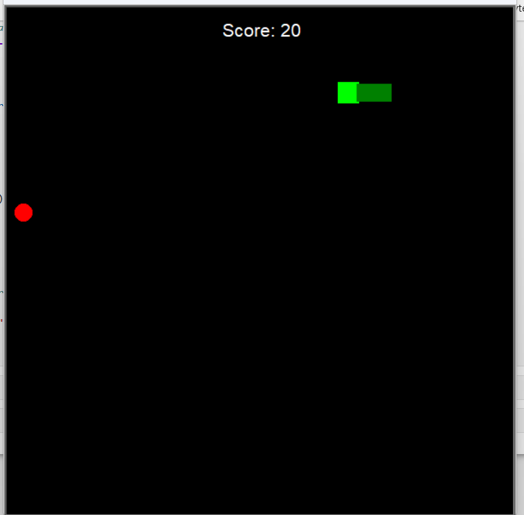

# 🐍 Snake Game

A classic Snake game in Python, built with the `turtle` library.
The snake grows with every apple it eats, and the game speeds up as you play.



## Features

- Control the snake with the keyboard arrow keys
- The snake grows each time it eats an apple
- Live score display (10 points per apple)
- Speed increases gradually, with a cap to keep the game playable
- Game over on collision with a wall or with the snake's own body
- The snake cannot reverse onto itself
- Food never spawns on top of the snake

## Requirements

- Python 3.8 or newer
- No libraries to install: `turtle`, `time` and `random` ship with Python

> On Linux, if `turtle` does not work, install Tkinter:
> `sudo apt install python3-tk`

## Run the game

```bash
git clone https://github.com/<LucAttisso>/snake-game.git
cd snake-game
python snake.py
```

## Controls

| Key | Action |
|-----|--------|
| ↑ | Move up |
| ↓ | Move down |
| ← | Move left |
| → | Move right |

The snake starts stationary: press an arrow key to begin.

## Settings

You can adjust the difficulty at the top of `snake.py`:

| Constant | Purpose | Default |
|----------|---------|---------|
| `START_DELAY` | Delay between two moves at the start (in seconds) | `0.15` |
| `MIN_DELAY` | Minimum delay, i.e. maximum speed | `0.04` |
| `SPEED_STEP` | Delay removed each time an apple is eaten | `0.005` |

## Note on Jupyter

The game is designed to run as a script (`python snake.py`).
In Jupyter, the `turtle` window closes when the game ends, and running the code
a second time can raise a `Terminator` error: restart the kernel in that case.

## Ideas for improvement

- Save the best score to a file
- Add a key to restart without relaunching the script
- Add obstacles or levels

## License

This project is released under the MIT License. See the [LICENSE](LICENSE) file.
